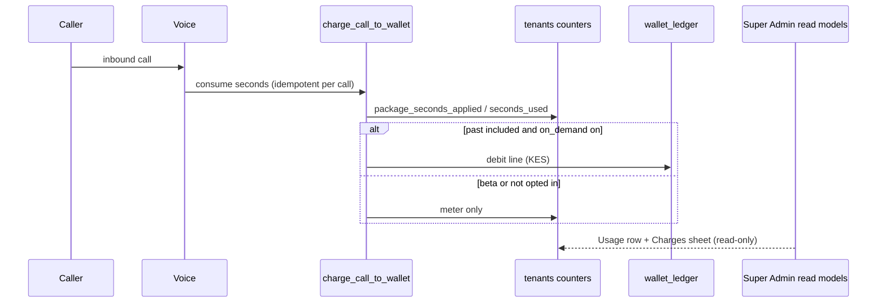
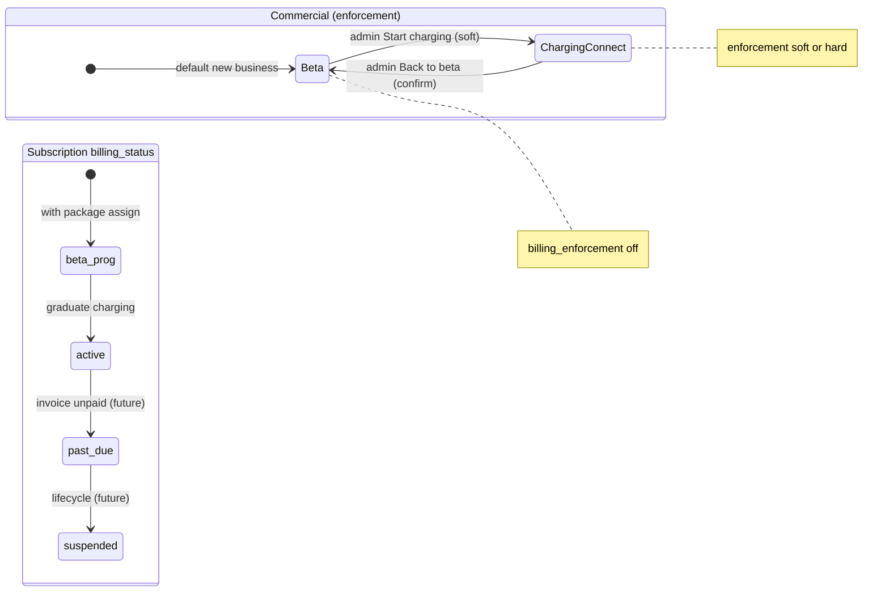
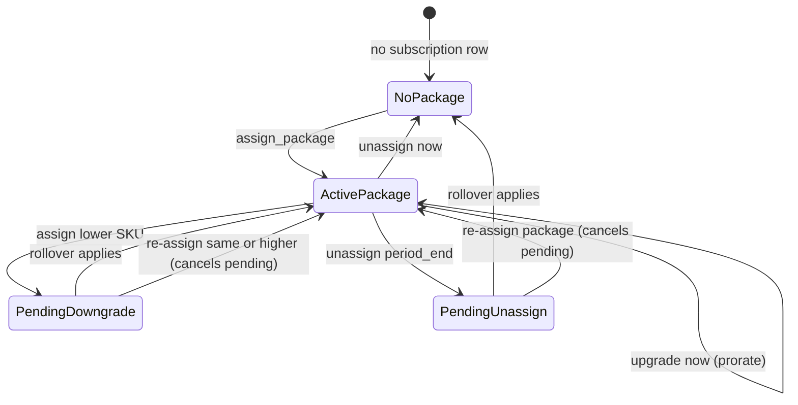
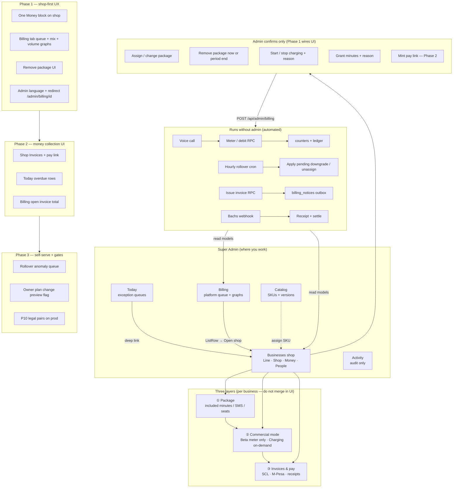

# Super Admin billing IA research

Research for simpler admin billing that matches Scalers packages + on-demand, lowers cognitive load, aligns with the shop hub (#787, #797), and sets up **automated** ops with **admin-only language** and **graphs** where they help decisions.

## Problem (why it feels bad today)

Operators hit **the same jobs in three or four places** with **different layouts and words**:

| Job | Where it appears today |
| --- | --- |
| Shop has no package | Today Needs you, Packages Needs you, Billing list filters, Shop Money |
| Change package / period | `/admin/billing/[id]`, Shop Package sheet, Packages Shops tab |
| Beta vs charging | Billing detail Charging, Shop Plan, Billing KPIs + columns |
| On-demand rates | Billing detail prose, Packages Rates sheet |
| Usage / minutes | Billing list, Billing detail, Shop Charges |
| Remove package | **API only** (`unassign_package`), no UI |
| Charge lines | Shop Charges sheet, Billing detail History |

The **Billing tab** is a second business directory (KPI tiles, seven-column table, orphan detail page). There are **no billing graphs** in admin today (Today has numeric volume rows, not charts).

**Copy leaks implementation:** "On-demand soft/hard", rate card paragraphs. The lane contract is **packages + on-demand**; owners opt in on the desk.

**Docs vs product:** `STATUS.md` says "admin billing console is not started" while partial UI exists. Invoices/pay exist in SQL and staging; **no admin invoice UI**.

---

## Mental model: three layers (combine, do not confuse)

Admin billing is not one toggle. Three layers stack:

| Layer | Stored as | What it means for ops | Charges money? |
| --- | --- | --- | --- |
| **1. Package assignment** | `tenant_subscriptions` + `tenants.*_included` / `*_used` | Which **included buckets** (minutes, SMS, seats) this business is metered against | No by itself |
| **2. Commercial mode** | `tenants.billing_enforcement` + `tenant_subscriptions.billing_status` | **Beta** (meter only) vs **Charging** (on-demand debits when owner opted in) | Only when Charging + opted in past included |
| **3. Money collection** | `invoices`, `payments`, pay tokens | Issued invoices, M-Pesa pay page, receipts | When live and not beta |

**Legal pairs** (enforced in SQL and package version editor):

- `billing_status = beta` ↔ `billing_enforcement = off`
- `billing_status = active` ↔ `billing_enforcement = soft` or `hard`

You cannot turn on Charging while `billing_status` is still beta (`billing_mode_legal_pairs.sql`). Pay links refuse beta (`invoice_pay.sql`).

### Why assign a package during Beta?

Beta means **no charges**, not **no limits**.

1. **Metering:** Voice and notify still consume **included minutes / message units**. Without a package, caps and "80% / 100% package" beta alerts have nothing sensible to attach to (`BETA_WALLET_PROGRAM.md`).
2. **Product rehearsal:** Ops and owners see the same **Plan / Usage** shape they will have when Charging starts. Desk shows "297 of 300 minutes" even when free during beta.
3. **Onboarding hygiene:** Today and Packages flag **live with no package**. That is a configuration gap, not a billing mode. Assign Starter (or Growth) while staying on Beta.
4. **Future automation:** Period rollover, proration, and owner plan-change RPCs assume an active subscription row (`package_state_rules.sql`, `owner_billing_actions.sql`). Beta businesses still carry `billing_status = beta` until graduation.

**Admin sentence:** "Package is what they are metered on. Beta means we do not charge yet."

### How to strip a package from someone

**Backend today:** `POST /api/admin/billing` with `action: "unassign_package"`, `when: "now" | "period_end"`, `note` (min 3 chars). RPC `unassign_tenant_package` (`package_state_rules.sql`):

| When | Effect |
| --- | --- |
| **now** | Subscription cancelled immediately; allowances rebuilt with **grant minutes kept** for the current period; `minutes_included` can go to 0 + grants |
| **period_end** | Schedules `pending_change = unassign` at term/period end; package stays until boundary |

**UI today:** none. Operators cannot do this from admin without API/tools. **Phase 1 must add** shop Money row **Remove package** → ConfirmSheet (now vs end of period, reason).

**Do not confuse with:** Shop Plan **Beta** (commercial mode) or archive business (line lifecycle).

---

## Automation map (what the billing system already does)

Admin should **surface state and exceptions**, not re-implement billing logic by hand.

| Process | Where it lives | Prod today | Admin should show |
| --- | --- | --- | --- |
| Call / SMS metering | Voice + `charge_call_to_wallet`, notify settle | Live | Usage rows, charge lines (read-only) |
| Package assign / upgrade / schedule | `assign_tenant_package` | Live | Confirm sheets; Activity audit |
| Package remove | `unassign_tenant_package` | Live API, **no UI** | Scheduled vs immediate stamp |
| Beta vs Charging | `admin_set_tenant_billing_mode` | Live | Plan row + legal pair guard |
| Period rollover + pending changes | `roll_package_periods` + pg_cron `scalers-package-period-rollover` (`5 * * * *`) | **Live on prod** (catch-up rebuild fix applied 19 Oct 2026) | Queue: period boundary today, pending downgrade/unassign due, rollover anomalies |
| Owner plan change / proration invoice | `owner_change_plan` etc. | Staging, desk flag off | Read-only preview when flag on |
| Issue invoice | `finalize_invoice` | Staging / partial prod | Invoice list, status stamp |
| Pay link mint | `mint_invoice_pay_token` | Staging | Copy link action (no raw token in list) |
| Payment record | webhook + `record_payment` | Staging | Receipt row, auto-settle |
| Billing notices queue | `billing_notices` + `sendClaimedBillingNotices` | Off unless `BILLING_NOTICES_SEND=on` | Outbox count on Platform or Billing, not send UI |
| Ops platform alerts | `/api/cron/ops-alerts` | Live cron | Platform notices (separate from billing) |
| Package version publish / move subs | package version editor API | Flag-gated | Catalog only; bulk move with confirm |

**Automation principle:** Default path is **system runs rules**; admin UI is for **assign package**, **graduate beta**, **grant minutes**, **confirm destructive**, **mint pay link**, **void draft**. Everything else is read + queue.

### End-to-end: one answered call (charging, opted in)



Invoice and pay sit **outside** the call path: owner RPC or admin issue → `billing_notices` queue → pay token → webhook → receipt. Admin never edits ledger lines.

### State: commercial mode vs subscription row

Two different clocks confuse operators. Keep them separate in UI copy.



Legal pair gate: **Start charging** must flip `billing_status` to `active` before enforcement can leave `off` (`billing_mode_legal_pairs.sql` on staging; prod P10 still pending per `STATUS.md`).

### State: package assignment and pending changes



**Cancel scheduled remove:** there is no separate RPC today. Re-assign the current package (or upgrade) clears `pending_change` (`package_state_rules.sql` rule 4). Phase 1 UI should expose **Cancel scheduled change** as that action with plain copy.

---

## Decision tree: should this business have a package?

Use on Today **Package** stamp and shop **Money**.

| Question | If yes | If no |
| --- | --- | --- |
| Is the line live or about to go live? | Assign a catalog SKU (usually Starter) | Archive / onboarding only: package optional |
| Will they take calls or send notify billable units? | **Yes, assign** — metering needs included buckets | Internal test with zero traffic: package optional but weak alerts |
| Are they in beta? | **Still assign** — beta = no charge, not unlimited | Do not leave live traffic on "no package" |
| Trial SKU (14d, 20 min)? | Only for explicit trial onboarding; not the default ops path | Use Starter/Growth for real businesses |
| Leaving Scalers entirely? | **Remove package** (now or period end) + archive line | Strip package before re-selling number from pool |

**One-line rule for training:** Live shop → always have a package row; beta only controls whether KES debits run.

---

## Scenario playbook (combinations you will hit)

Each row: what the operator sees → where to act → what automation does.

| # | Situation | Signals | Admin action | Automation / rules |
| --- | --- | --- | --- | --- |
| 1 | New business, line live, beta | No package; Beta stamp | Shop Money: assign package; stay Beta | Assign sets subscription + included buckets; no charge |
| 2 | Live, no package | Today Package stamp | Assign from shop | Same as #1 |
| 3 | Beta, low minutes | Usage near cap; Beta | Grant minutes **or** assign larger package | Grants add to included; calls still connect in beta |
| 4 | Beta, exhausted, no on-demand | Exhausted stamp | Grant minutes or upgrade package; optional owner comms | Beta never blocks calls (`BETA_WALLET_PROGRAM`) |
| 5 | Graduate to paid ops | Product go | Shop Plan: **Start charging** (soft) | Sets `billing_status active` + enforcement soft; confirm sheet |
| 6 | Charging, owner not opted in | Past included, no debits | Wait or owner enables Usage opt-in | Debits only when `on_demand_usage_enabled` |
| 7 | Charging, opted in, past included | Charge lines in ledger | Read Charges; no manual debit | Idempotent `charge_call_to_wallet` |
| 8 | Upgrade package mid-period | Assign Growth from Starter | Shop Package → review change | `assign_tenant_package` prorates minutes (upgrade now) |
| 9 | Downgrade | Assign lower SKU | Confirm schedule at period end | `downgrade_scheduled` pending |
| 10 | Remove package entirely | Leaving prepaid program | **Remove package** (new UI): now vs period end | `unassign_tenant_package` |
| 11 | Scheduled unassign due | Pending stamp | Read-only until rollover | `roll_package_periods` applies pending |
| 12 | Open invoice, beta business | Cannot pay | Do not issue; fix mode first | `finalize_invoice` / pay link refuse beta |
| 13 | Open invoice, active | Owner owes | Mint pay link once; owner pays | Webhook records payment; receipt auto |
| 14 | Split M-Pesa (>150k) | Pay page Part 1 of N | No admin split math | Pay page handles parts |
| 15 | Version editor: new prices | Catalog v3 published | Move subscribers (confirm) | Bulk pin version; audit per business |
| 16 | Archived business | Archived stamp | No billing changes; line state only | Billing reads inactive |
| 17 | Trial ending | Trial minutes low; `trialing` status | Assign paid SKU or extend via catalog rules | Not a normal "Starter checkout"; admin assign |
| 18 | Grandfathered version | Catalog shows v2 live, business on v1 | Catalog **Move subscribers** (confirm) or leave | Prices on row = pinned version, not catalogue headline |
| 19 | Cancel scheduled downgrade | Pending stamp on Package | Re-assign current SKU or upgrade | SQL clears `pending_*` |
| 20 | Cancel scheduled remove | Pending unassign stamp | Re-assign same package | Same as #19 |
| 21 | Grant + assign same day | Activity shows both | Grant for goodwill; assign for cap shape | Grants stack on included; idempotency key on grant |
| 22 | Charging but owner never opted in | Exhausted + no charge lines | Comms: opt in on Usage; or grant minutes | No admin "force opt-in" in lane contract |
| 23 | P10 not on prod yet | Start charging fails or inconsistent | Wait for SQL apply or use staging | `set_tenant_billing_mode` beta refusal staging-only today |
| 24 | SMS 80/100% beta email | Platform notice, not billing tab | Read-only; fix minutes or package | `smsUsageAlerts.js` + minute notices |
| 25 | Counter drift after incident | Usage wrong vs calls table | Staging-only reconcile SQL; prod via approved runbook | Do not expose "repair" in product UI |
| 26 | Open pay session stuck | Owner sees "Previous payment still processing" | Read payment_attempts; no manual settle in UI | Bachs webhook + review apply paths (#780) |
| 27 | Multi-seat over downgrade target | Owner RPC blocks downgrade | Admin schedule downgrade anyway or remove seats first | `owner_billing_actions` seat guard |
| 28 | Invoice credit from overpay | Negative amount due on invoice | Read-only credit row | `tenant_credits`, not wallet |

---

## Admin write surface (today’s API)

All writes: `POST /api/admin/billing` unless noted. Every destructive action needs **note ≥ 3 chars** and lands in **Activity**.

| Admin label (proposed) | `action` | Key body fields | Confirms |
| --- | --- | --- | --- |
| Assign / change package | `assign_package` | `package_id`, `period` | Proration summary when upgrade |
| Remove package | `unassign_package` | `when`: `now` \| `period_end` | Now vs end of period |
| Start / stop charging | `set_billing_mode` | `mode`: `off` \| `soft` \| `hard` | Legal pair + reason |
| Grant minutes | `grant_minutes` | `minutes`, optional `idempotency_key` | Reason |

**Not on this route (other admin APIs):** package version publish/move (`/api/admin/packages/...`), DID pool, business archive. **Not in product:** ledger repair, waive overage, wallet adjust.

**Reads:** `GET /api/admin/billing` → overview KPIs + rows; `?history_for=<id>` → merged history for shop **History** sheet.

---

## Admin language vs owner language

Same facts, different vocabulary. Admin is **operational and precise**; owner is **plain and outcome-based**.

| Concept | Owner desk | Super Admin (proposed) |
| --- | --- | --- |
| Commercial mode | "Free during beta" / plan name | **Beta · Meter only** / **Charging · On-demand** |
| Enforcement soft/hard | (hidden) | **Charging · Connect** vs **Charging · Block at cap** (only when hard ships) |
| Package | "Starter", "Growth" | **Package · Starter / month** |
| No package | (empty plan) | **No package assigned** |
| Usage | "297 of 300 minutes" | **Minutes 297 / 300 · period ends 31 Oct** |
| On-demand | Opt-in on Usage | **Owner opted in: Yes/No** (Money row) |
| Charge lines | Usage history | **Charges** (ledger lines, not "wallet") |
| Grant | (invisible) | **Grant minutes** + reason (audit) |
| Remove package | N/A | **Remove package** · now / end of period |
| Invoice | Billing list | **Invoice SCL-… · Open · KSh … · Due …** |
| Pay link | Pay button | **Pay link · Copy** (mint once) |
| Beta status in DB | N/A | Never say `billing_status`; say **Beta program** or **On record: beta** in Activity only |

Avoid on admin screens: tenant, enforcement, soft/hard, RPC names, Bachs, env vars, ledger repair.

---

## Graphs and metrics (admin-only, decision-first)

No charts exist in admin billing today. Add **sparse, tabular-first** visuals (Frontend 2.0: numbers are `tabular-nums`; graphs supplement lists, do not replace them).

### Billing tab (platform scope)

When Billing becomes a **queue + dashboard** (not a second directory):

| Block | Type | Purpose |
| --- | --- | --- |
| **Attention** | Segmented queue + counts | Needs you: no package, low minutes, exhausted, overdue invoice (later) |
| **Mix** | Horizontal bar or stacked strip | Beta vs Charging business count (not KPI tiles) |
| **Volume** | Sparkline or thin bar, 7d / 30d | Total **included minutes consumed** across platform (from tenants.seconds_used deltas), EAT |
| **Revenue prep** | Single line + table | Open invoice total KSh (when invoices live); **not** cash until pay prod |
| **Catalog health** | ListRow | Published version per SKU; businesses on grandfathered version count |

Use the same pattern as Today **Volume today**: compare to prior period ("Last 7d: …"), not decorative charts.

### Shop Money (business scope)

| Row / sheet | Visual |
| --- | --- |
| Usage | Progress bar (minutes, SMS) like owner Plan, plus **period end** date |
| Charges sheet | Simple daily bar of KSh by day (last 30d) if >10 lines; else list only |
| Invoices (phase 2) | Status stamps; no pie charts |

### Catalog

| Visual | Purpose |
| --- | --- |
| Table only for SKUs | Prices, minutes, live/off |
| Version editor | Subscriber count per version (numeric), not graph |

**Implementation note:** Prefer CSS bar segments or lightweight SVG in admin theme. No new chart library unless desk gate approves bundle cost. Playwright visual gate still applies.

### Wireframe: Billing tab (platform)

```text
┌─ Billing ─────────────────────────────────────────────┐
│ [Needs you] [All] [Beta] [Charging]   ← Segmented    │
├───────────────────────────────────────────────────────┤
│ Attention (counts)                                     │
│  • No package .............. 3   → filter list        │
│  • Low minutes ............. 7                        │
│  • Exhausted (no opt-in) ... 2                        │
│  • Open invoices ........... 0   (phase 2)            │
├───────────────────────────────────────────────────────┤
│ Mix   Beta ████████████░░  42                        │
│       Charging ████░░░░░░  18                        │
├───────────────────────────────────────────────────────┤
│ Minutes consumed (platform)                            │
│  7d  ▂▃▅▇▆▄▃  1.2M min   vs prior 7d +4%             │
│  30d thin bar + total                                  │
├───────────────────────────────────────────────────────┤
│ ListRow queue (not 7-column table)                     │
│  Acme Ltd · Low minutes · 12 / 300 · Beta · Open shop │
└───────────────────────────────────────────────────────┘
```

Deep link: `/admin/businesses/<id>?money=1` (or shop anchor), not `/admin/billing/<id>`.

### Wireframe: shop Money (business)

```text
Package     Starter / month          [Change] [Remove]
Plan        Beta · Meter only        [Start charging]
Usage       ████████░░  240 / 300 min · ends 31 Oct
Owner opt-in   No
Charges     12 lines this period     [Open]
Grant       [Add minutes]
History     [Open]
Invoices    (phase 2)
```

---

## Exception queues (automated detection, manual only when needed)

| Queue | Detection (read model) | Operator action | Do not |
| --- | --- | --- | --- |
| No package + active line | Today + billing overview | Assign package | Toggle beta to "fix" |
| Period ends in 48h + pending | `pending_effective_at` | Confirm stamp; wait for cron | Manual counter zero |
| Rollover catch-up | `seconds_used` rebuild audit | Read Activity; escalate if pattern repeats | Hand-edit counters |
| Notice outbox stuck | `billing_notice_outbox` sending >15m | Platform read-only; infra sender | Resend from admin UI v1 |
| Pay webhook backlog | `payment_events` unprocessed | Runbook / Platform | Mark paid in UI |
| Version drift | subs on archived version | Catalog move with confirm | Silent bulk move |

Queues belong on **Billing** and **Today**, not buried in detail pages.

---

## IA target (recommended)

```text
Today       → queues (package, minutes, invoices when live)
Businesses  → shop (Line · Shop · Money · Line state · People)
Billing     → platform queue + graphs + filters → deep-link shop Money
Catalog     → SKUs, rates, versions (platform)
Activity    → audit trail (all writes)
```

### Shop Money rows (single component, shared sheets)

1. **Package** · name / period · change / remove
2. **Plan** · Beta or Charging · start/stop charging
3. **Usage** · minutes + message credits · period end
4. **Owner opt-in** · on-demand yes/no (read-only)
5. **Charges** · open sheet
6. **Grant minutes** · sheet
7. **Invoices** (phase 2) · list + mint link
8. **History** · merged Activity + ledger (last N)

Retire `/admin/billing/[id]` as a separate layout (redirect to shop).

---

## Advanced admin functions (automated vs confirm)

| Function | Automation level | UI pattern |
| --- | --- | --- |
| Meter usage | Fully automatic | Read-only Usage |
| Apply package upgrade now | Automatic after confirm | ConfirmSheet with proration lines |
| Schedule downgrade / unassign | Automatic at rollover | Stamp **Scheduled · date**; **Cancel** = re-assign same package |
| Graduate beta → charging | Manual confirm once | ConfirmSheet + reason → Activity |
| Grant minutes | Manual, idempotent key | Sheet + reason |
| Issue invoice | Manual or owner RPC | Confirm; system assigns SCL number |
| Mint pay link | Manual once per invoice | Button; rotate = confirm |
| Record payment | Webhook automatic | Read receipt |
| Send billing email/SMS | Cron when flag on | Platform/Billing **Outbox: N pending** read-only |
| Move many businesses to new version | Manual bulk confirm | Catalog editor |
| Rollover periods | Hourly cron on prod | Exception queue only |

**Heavy automation, light UI:** ops should live in **queues and stamps**, not forms.

---

## Master blueprint (diagram + plan)

One picture: **where ops work**, **what the system runs alone**, **three money layers**, and **delivery phases**.



**Reading the diagram:** Operators live in **Today + Billing + shop Money**. The engine **meters, rolls periods, queues notices, records pay**. Admin touches **four writes today** (assign, unassign, mode, grant) plus pay link later. **Package during beta** feeds layer ① while layer ② stays “meter only.”

---

## Phased delivery

### Phase 1 (UX + missing strip package)

1. Shop-first Money block (shared with billing detail logic).
2. Billing tab → queue + platform graphs (mix + volume).
3. **Remove package** UI wired to existing API.
4. Admin language pass (table above).
5. Redirect billing client route; drop duplicate Packages Shops tab.

### Phase 2 (invoices on prod)

1. Shop Invoices + pay link mint.
2. Today overdue / open invoice rows.
3. Revenue block on Billing tab.

### Phase 3 (owner self-serve + hard gates)

1. Admin queue for rollover anomalies (catch-up rebuild spikes).
2. Surface owner plan-change previews when `DESK_PLAN_CHANGE` on.
3. Apply P10 `billing_mode_legal_pairs.sql` on prod before advertising **Start charging** everywhere.

---

## Success checks

- Operator explains: "Package = meter buckets; Beta = no charge; Charging = bill past included when they opted in."
- Strip package: two taps + reason, visible in Activity.
- No `/admin/billing/[id]` duplicate; one Money block component.
- Billing tab shows at least one graph + queue without seven-column table.
- Tests cover unassign UI guard + redirect.

---

## References

- `docs/reference/lanes/OPS_BILLING.md`
- `docs/explanation/billing/BETA_WALLET_PROGRAM.md`
- `docs/reference/operations/SUPER_ADMIN_REQUIREMENTS.md`
- `docs/reference/operations/BILLING_READ_MODELS.md`
- `docs/reference/operations/OWNER_BILLING_ACTIONS.md`
- `docs/reference/operations/INVOICE_PAY.md`
- `docs/supabase/package_state_rules.sql`, `package_period_rollover.sql`, `billing_mode_legal_pairs.sql`
- `dashboard/src/app/api/admin/billing/route.ts`
- `dashboard/src/components/AdminBilling*.tsx`, `AdminShopPanel.tsx`, `AdminPackagesPanel.tsx`
